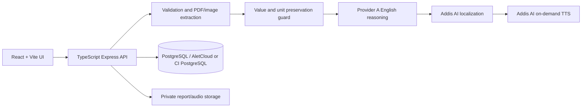

# LisanHealth

<strong>Your health report, in your language.</strong>

LisanHealth is an Ethiopian-focused multilingual medical-report explainer for English, Amharic (`am`), Afaan Oromoo (`om`), and Tigrinya (`ti`). It provides structured educational explanations and on-demand speech. It is not a diagnostic, prescribing, or treatment system.

  

## Product flow

1. An authenticated user uploads a PDF, PNG, or JPEG laboratory report.
2. The backend validates type, signature, size, and processing limits.
3. Deterministic extraction preserves values, units, signs, and reference intervals.
4. Provider A creates a structured English explanation; Addis AI localizes it to the selected language.
5. Safety checks prevent downstream text from changing extracted clinical facts.
6. Addis AI speech is generated only when the user presses Play.
7. Private report metadata and history are stored in PostgreSQL for the owning user.

| Code | Language | Text | Speech |
|---|---|---:|---:|
| `en` | English | Yes | Provider configuration dependent |
| `am` | አማርኛ (Amharic) | Yes | Addis AI |
| `om` | Afaan Oromoo | Yes | Addis AI |
| `ti` | ትግርኛ (Tigrinya) | Yes | Addis AI/provider configuration dependent |

## Architecture

## Repository map

| Area | Purpose |
|---|---|
| `backend/` | TypeScript Express API, Prisma schema, authentication, persistence, and AI pipeline |
| `frontend/` | React/TypeScript/Vite UI, language selection, reports, and audio player |
| `infrastructure/` | Docker, Kustomize, Helm, Terraform, GitOps, and monitoring |
| `docs/` | Product, requirements, architecture, testing, security, and approval gates |
| `.github/workflows/` | CI quality gates and CD validation/image publishing |

## Local development (Windows PowerShell)

Copy `.env.example` to `.env`, edit it locally, and never commit secrets. Then run `npm ci`, `npm run build`, `npm test`, `npm run test:api`, and `npm run dev` inside `backend`. In a second terminal run `npm ci` and `npm run dev` inside `frontend`. Open `http://localhost:5173`; the API normally listens on `http://localhost:8000`. Check `/api/v1/health` and `/api/v1/ready` before uploads. Use a dedicated AletCloud/PostgreSQL development database, never production.

## Docker Compose

Run `docker compose config`, then `docker compose up --build -d`, `docker compose ps`, and `Invoke-WebRequest http://localhost:8000/api/v1/health`. Stop with `docker compose down`. Docker Hub TLS timeouts are network/image-download failures; renaming a cached Postgres tag does not replace missing Node or Nginx base images.

## Verification and delivery

Backend and frontend builds/tests, disposable PostgreSQL integration tests, Docker/Compose, Kustomize, Helm, Terraform, dependency/security checks, and GHCR publishing are covered by CI. ZAP/Trivy results are security evidence requiring review; a green workflow is not a professional penetration test.

Terraform provisions an AWS EKS cluster with EC2-backed worker nodes; it is not an already deployed AWS environment. Before `terraform apply`, configure approved remote state, AWS/OIDC credentials, DNS/TLS, secrets, PostgreSQL network access, backups, and cost limits. See [infrastructure/README.md](infrastructure/README.md).

## Documentation

- [Backend guide](backend/README.md) · [Frontend guide](frontend/README.md) · [Infrastructure/AWS guide](infrastructure/README.md)
- [PRD](docs/PRD.md) · [SRS](docs/SRS.md) · [Architecture](docs/architecture.md)
- [Testing](docs/testing.md) · [Security](docs/security.md) · [Implementation roadmap](docs/implementation-plan.md)
- [External approval gates](docs/external-approval-gates.md)

## Safety, privacy, and release status

LisanHealth does not diagnose illness, prescribe medicine, change treatment, or replace a qualified clinician. Do not upload unnecessary personal identifiers. Development and CI use synthetic data. Commercial launch still requires clinical safety, Ethiopian privacy/legal, data-protection, native-language, backup/restore, and professional penetration-test reviews.

Licensed under the [MIT License](LICENSE).

**© 2026 Yeabsera Andnet · LisanHealth**
