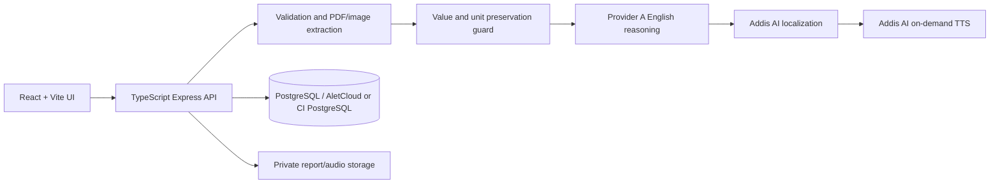
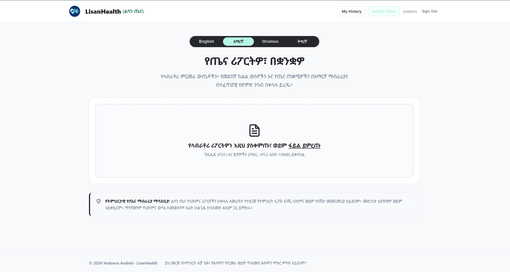
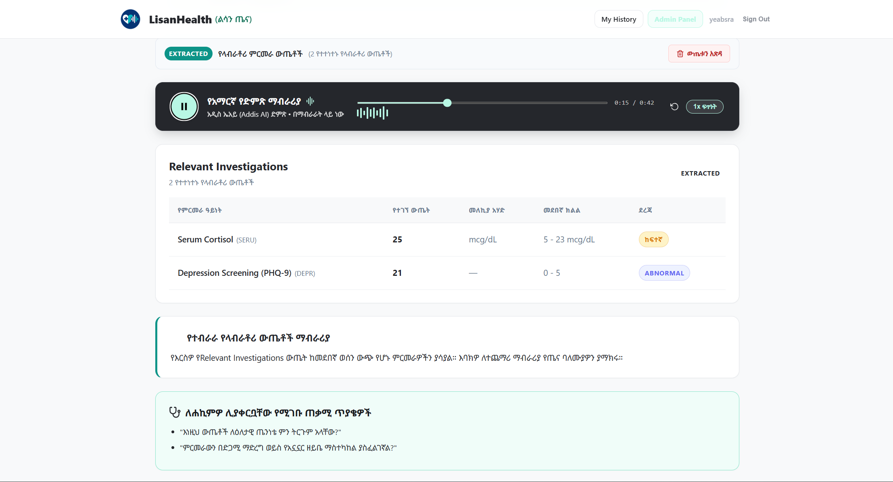
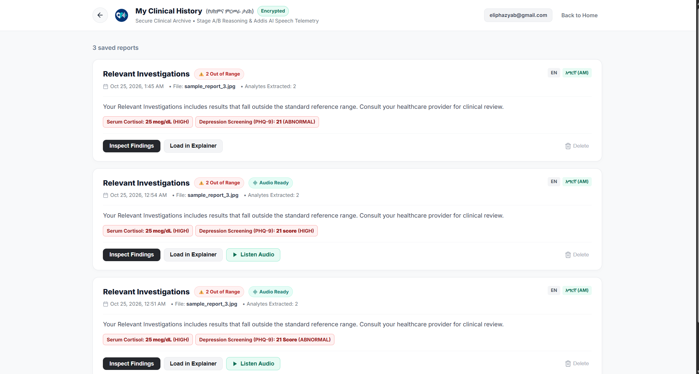
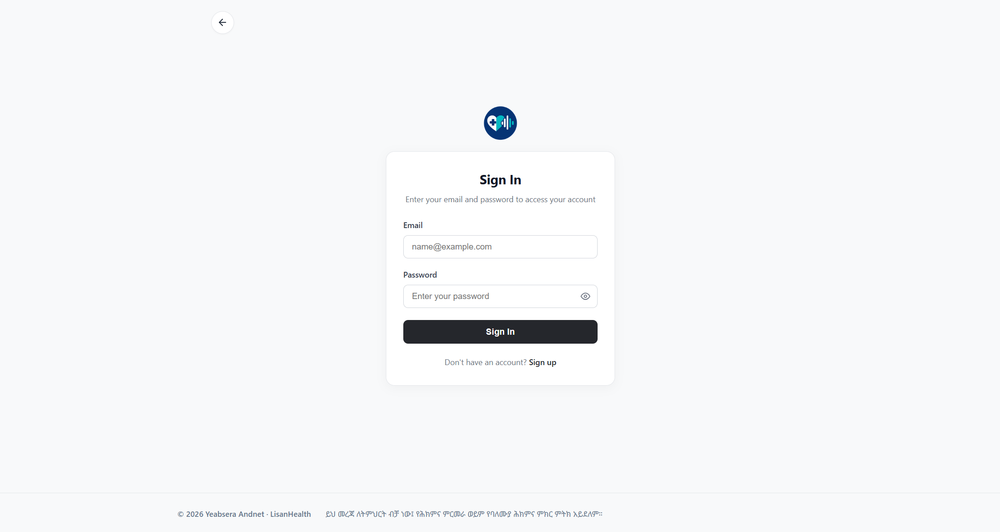

# LisanHealth(ልሳን ጤና)

<p align="center"></p>
<p align="center"><strong>LisanHealth · ልሳን ጤና</strong><br />Your health report, in your language</p>
<p align="center"><sub>Multilingual explanations and Addis AI speech in Amharic, Afaan Oromoo, and Tigrinya</sub></p>

LisanHealth is an Ethiopian-focused multilingual medical-report explainer for English, Amharic (`am`), Afaan Oromoo (`om`), and Tigrinya (`ti`). It provides structured educational explanations and on-demand speech. It is not a diagnostic, prescribing, or treatment system.

[](https://github.com/Eliphaz21/Lisan_Health/actions/workflows/ci.yml) [](LICENSE) [](https://nodejs.org/)

| Product | Deployment |
|---|---|
| Live demo | **Coming soon — AWS deployment pending** |
| Public API health | **Coming soon — add the deployed `/api/v1/health` URL after launch** |
| Source code | [github.com/Eliphaz21/Lisan_Health](https://github.com/Eliphaz21/Lisan_Health) |

## Product flow

1. An authenticated user uploads a PDF, PNG, or JPEG laboratory report.
2. The backend validates type, signature, size, and processing limits.
3. Deterministic extraction preserves values, units, signs, and reference intervals.
4. Provider A creates a structured English explanation; Addis AI localizes it to the selected language.
5. Safety checks prevent downstream text from changing extracted clinical facts.
6. Addis AI speech is generated only when the user presses Play.
7. Private report metadata and history are stored in PostgreSQL for the owning user.

| Code | Language | Text | Speech |
|---|---|---:|---:|
| `en` | English | Yes | Provider configuration dependent |
| `am` | አማርኛ (Amharic) | Yes | Addis AI |
| `om` | Afaan Oromoo | Yes | Addis AI |
| `ti` | ትግርኛ (Tigrinya) | Yes | Addis AI/provider configuration dependent |

## Architecture



## Repository map

| Area | Purpose |
|---|---|
| `backend/` | TypeScript Express API, Prisma schema, authentication, persistence, and AI pipeline |
| `frontend/` | React/TypeScript/Vite UI, language selection, reports, and audio player |
| `infrastructure/` | Docker, Kustomize, Helm, Terraform, GitOps, and monitoring |
| `docs/` | Product, requirements, architecture, testing, security, and approval gates |
| `.github/workflows/` | CI quality gates and CD validation/image publishing |

## DevOps stack

The project demonstrates the complete delivery path: Git and GitHub Actions for CI/CD, multi-stage Docker images and Compose for local environments, Kustomize and Helm for Kubernetes packaging, Terraform for AWS VPC/EKS infrastructure, GHCR for immutable container images, and Prometheus/Grafana configuration for observability. AWS deployment remains an account-specific step described in the infrastructure guide.

## Run the project locally

Follow this guide in Windows PowerShell. You need Node.js, Git, and a running PostgreSQL database. For cloud-backed development, use a dedicated AletCloud database with synthetic records only.

### Step 1 — Configure the environment

From the repository root:

```powershell
Copy-Item .env.example .env
```

Open `.env` and add your local development values. Keep this file private. Never commit passwords, database URLs, or AI keys.

### Step 2 — Start the backend

Open PowerShell window 1:

```powershell
Set-Location backend
npm ci
npm run build
npm test
npm run dev
```

The API should run at `http://localhost:8000`.

### Step 3 — Start the frontend

Open PowerShell window 2, leaving the backend running:

```powershell
Set-Location frontend
npm ci
npm run dev
```

Open `http://localhost:5173` in your browser.

### Step 4 — Check the connection

Open this address in a browser or run:

```powershell
Invoke-WebRequest http://localhost:8000/api/v1/health
```

The backend health response should be successful before you test uploads.

### Step 5 — Test the main flow

1. Create an account or sign in.
2. Choose English, Amharic, Afaan Oromoo, or Tigrinya.
3. Upload a synthetic PDF, PNG, or JPEG report.
4. Review the extracted values and reference ranges.
5. Read the localized explanation and doctor questions.
6. Press **Play** to request Addis AI speech.
7. Open History to confirm that the report belongs to your account.

### Optional — Run with Docker Compose

From the repository root:

```powershell
docker compose config
docker compose up --build -d
docker compose ps
```

Open `http://localhost:5173` and check the backend at `http://localhost:8000/api/v1/health`. Stop the containers when finished:

```powershell
docker compose down
```

Use a dedicated development database for cloud-backed testing. Never connect local experiments to production data.

## Addis AI speech workflow

1. Provider A extracts and explains the report in a structured English result.
2. Addis AI converts that approved result into the selected local language: Amharic, Afaan Oromoo, or Tigrinya. English remains available as the source language.
3. The localized explanation, safety disclaimer, cultural context, and doctor questions are shown as text.
4. Speech is generated only after the user presses **Play**, using the selected language voice configured for Addis AI.
5. The backend authenticates and stores the generated audio privately with the user’s report history; it is never publicly served.
6. If speech generation fails, the localized text remains available and the UI shows a clear error instead of an empty audio player.

Audio availability depends on the configured Addis AI voice and valid server-side credentials. The browser never receives the Addis AI API key.

## Delivery and AWS status

CI validates backend/frontend builds and tests, disposable PostgreSQL, Docker, Kustomize, Helm, Terraform, dependency/security checks, and GHCR publishing. ZAP/Trivy results are security evidence requiring review; a green workflow is not a professional penetration test.

Terraform provisions an AWS EKS cluster with EC2-backed worker nodes; it is not an already deployed AWS environment. Before `terraform apply`, configure approved remote state, AWS/OIDC credentials, DNS/TLS, secrets, PostgreSQL network access, backups, and cost limits. See [infrastructure/README.md](infrastructure/README.md).

## Documentation

- [Backend guide](backend/README.md) · [Frontend guide](frontend/README.md) · [Infrastructure/AWS guide](infrastructure/README.md)
- [PRD](docs/PRD.md) · [SRS](docs/SRS.md) · [Architecture](docs/architecture.md)
- [Testing](docs/testing.md) · [Security](docs/security.md) · [Implementation roadmap](docs/implementation-plan.md)
- [External approval gates](docs/external-approval-gates.md)

## Safety, privacy, and release status

LisanHealth does not diagnose illness, prescribe medicine, change treatment, or replace a qualified clinician. Do not upload unnecessary personal identifiers. Development and CI use synthetic data. Commercial launch still requires clinical safety, Ethiopian privacy/legal, data-protection, native-language, backup/restore, and professional penetration-test reviews.

Licensed under the [MIT License](LICENSE).

**© 2026 Yeabsera Andnet · LisanHealth**

## Product screenshots

These screenshots show the current product experience using synthetic data. They cover the multilingual home screen, localized report explanation with Addis AI speech, saved report history, and authentication.

The screenshots are stored separately from application assets so they do not increase the production web bundle.

### Multilingual upload experience



The home screen demonstrates the four-language selector, Amharic interface, authenticated navigation, upload area, and medical safety notice.

### Localized report and Addis AI speech



This view shows extracted laboratory values, reference ranges, localized explanation, doctor questions, and the Addis AI audio player.

### Private report history



History displays saved reports for the signed-in user, out-of-range indicators, language labels, and audio availability.

### Secure sign-in



The sign-in screen protects report upload, history, and speech access behind authentication.
