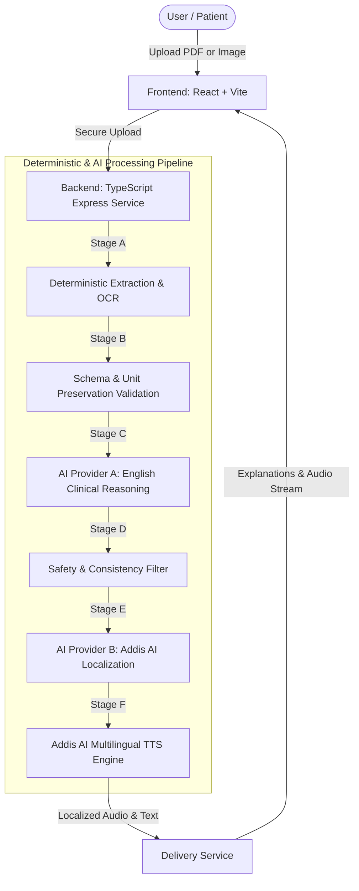

# LisanHealth (ልሳን ጤና)

> **"Your Health Report, in Your Language."**
> A multilingual medical laboratory report explainer designed for Ethiopia, delivering evidence-grounded explanations and natural audio in **English**, **Amharic (አማርኛ)**, and **Afaan Oromoo**.

[](https://github.com/Eliphaz21/Lisan_Health/actions)
[](LICENSE)
[](https://nodejs.org/)
[](https://www.docker.com/)

---

## 1. Project Purpose & Scope

In Ethiopia, medical laboratory reports are predominantly printed in English, using dense clinical abbreviations, technical units, and reference ranges that patients and caregivers struggle to understand.

**LisanHealth** bridges this communication barrier by:
1. Extracting text from laboratory PDFs and scanned images.
2. Grounding clinical explanations in verified reference intervals using **Dual-AI Architecture**.
3. Localizing explanations into **Amharic** and **Afaan Oromoo** via **Addis AI**.
4. Generating natural spoken audio (Text-to-Speech) for accessibility.
5. Providing structured questions to empower patients when consulting their physician.

> [!IMPORTANT]
> **Medical Disclaimer:** LisanHealth is an **educational explainer**, NOT a medical diagnostic system. It does not replace a doctor, diagnose conditions, prescribe medications, or alter treatment plans.

---

## 2. Architecture: Dual-AI Pipeline



---

## 3. Implemented vs. Planned Features

| Feature | Status | Description |
| :--- | :--- | :--- |
| **Project Setup & Documentation** | **Implemented** | Full PRD, SRS, Architecture, Testing, Security, and ADR documentation. |
| **TypeScript Express API** | **Implemented** | Authenticated, rate-limited API with health checks, report history, uploads, and speech routes. |
| **Synthetic Report Pipeline** | **Implemented** | Deterministic extraction and safety validation for synthetic PDF/image/text workflows. |
| **Dual-AI Provider Integration** | **Implemented** | Clinical reasoning plus Addis AI localization and Tigrinya language support. |
| **React + TypeScript Web UI** | **Implemented** | Accessible dashboard with four-language selection and audio player. |
| **Docker & Compose Environment** | **Implemented** | Multi-stage images and PostgreSQL Compose service with health checks. |
| **Kubernetes & Helm** | **Implemented** | Deployment manifests, security controls, health probes, and resource policies. |

---

## 4. Prerequisites

- **OS:** Windows 10/11 with PowerShell
- **Node.js:** v20+ (v24 recommended)
- **Docker Desktop:** Version 25+
- **Git:** Version 2.40+

---

## 5. Local Development Setup (Windows PowerShell)

### Backend Setup (TypeScript)
```powershell
# 1. Clone repository
git clone https://github.com/Eliphaz21/Lisan_Health.git
cd Lisan_Health

# 2. Configure environment
Copy-Item .env.example .env

# 3. Install backend dependencies
Set-Location backend
npm install

# 4. Build and test the backend
npm run build
npm test
npm run test:api

# 5. Start the backend development server
npm run dev
```

### Frontend Setup
```powershell
# In a new PowerShell terminal
cd frontend
npm install
npm run dev
```

---

## 6. Docker & Container Verification
```powershell
# Build and run complete multi-container stack
docker compose up --build -d

# Check running services and health status
docker compose ps
curl http://localhost:8000/api/v1/health
```

---

## 7. Documentation Index

- [PRD (Product Requirements Document)](file:///d:/.desktop/lisan_health/docs/PRD.md)
- [SRS (Software Requirements Specification)](file:///d:/.desktop/lisan_health/docs/SRS.md)
- [Architecture & Diagrams](file:///d:/.desktop/lisan_health/docs/architecture.md)
- [11-Week DevOps Roadmap & Sprint Plan](file:///d:/.desktop/lisan_health/docs/implementation-plan.md)
- [Design System & UI Guidelines](file:///d:/.desktop/lisan_health/docs/design.md)
- [Security, Privacy & Threat Model](file:///d:/.desktop/lisan_health/docs/security.md)
- [Testing Strategy & Test Matrix](file:///d:/.desktop/lisan_health/docs/testing.md)
- [Architecture Decision Records (ADRs)](file:///d:/.desktop/lisan_health/docs/decisions/)

---

## 8. License & Privacy
Licensed under the [MIT License](LICENSE).  
**Data Privacy:** LisanHealth uses synthetic laboratory data in development and testing. Real patient health information must never be committed to source control or sent across unverified networks.
