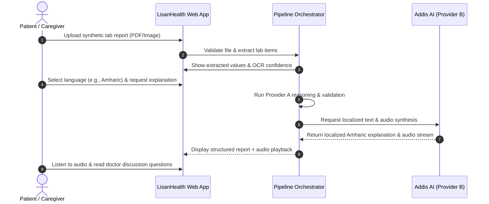

# LisanHealth — Product Requirements Document (PRD)

**Document Version:** 1.0.0  
**Status:** Approved  
**Author:** LisanHealth Engineering Team  
**Working Tagline:** "Your Health Report, in Your Language."

---

## 1. Problem Statement
In Ethiopia, over 80% of medical laboratory diagnostic reports are issued in English with clinical jargon, chemical shorthand (e.g., ALT, AST, eGFR, HbA1c), reference ranges, and unfamiliar metric units. For patients whose primary languages are **Amharic** or **Afaan Oromoo**, this creates severe health literacy friction, heightened anxiety, and miscommunication with caregivers and physicians. Furthermore, traditional generic LLM chatbots frequently hallucinate clinical assessments, fail to respect local Ethiopian linguistic nuances, and omit accessible voice/audio for individuals who prefer spoken communication.

---

## 2. Product Vision & Goals

### 2.1 Vision
To deliver an accessible, privacy-preserving, multilingual laboratory report explainer for Ethiopia that transforms dense technical results into understandable, culturally respectful text and spoken audio.

### 2.2 Core Product Goals
- **G-1 (Multilingual Accessibility):** Deliver clear, accurate explanations in **English**, **Amharic (አማርኛ)**, and **Afaan Oromoo**.
- **G-2 (Dual-AI Grounding):** Decouple clinical reasoning (AI Provider A) from Ethiopian localization and speech synthesis (Addis AI Provider B).
- **G-3 (Audio Inclusivity):** Provide natural text-to-speech (TTS) audio narration for every generated explanation.
- **G-4 (Zero Hallucination / Unit Preservation):** Preserve extracted lab values, signs, and reference intervals deterministically.
- **G-5 (DevOps Excellence):** Serve as a showcase 11-week DevOps and cloud architecture project (Docker, CI/CD, Kind, Helm, Prometheus).

### 2.3 Non-Goals (Out of Scope)
- **NG-1:** We do **NOT** diagnose medical illnesses or predict patient prognosis.
- **NG-2:** We do **NOT** prescribe, recommend, or adjust dosages of medications.
- **NG-3:** We do **NOT** recommend individualized traditional Ethiopian herbal remedies based on lab data.
- **NG-4:** We do **NOT** integrate with proprietary electronic health record (EHR) hospital databases in the initial MVP.

---

## 3. Target User Personas

| Persona | Demographics | Core Need | Key Challenge |
| :--- | :--- | :--- | :--- |
| **Abebe (Patient)** | 48, Addis Ababa, Amharic speaker | Understand his blood glucose and lipid panel before seeing his physician. | Finds medical English abbreviations confusing and anxiety-provoking. |
| **Chaltu (Caregiver)** | 34, Adama, Afaan Oromoo speaker | Review elder mother's complete blood count (CBC) report. | Prefers listening to spoken explanations in Afaan Oromoo while managing farm chores. |
| **Dr. Dawit (Physician)** | 38, Clinician, Hawassa | Patients who arrive informed with focused questions instead of panic. | Spends 50% of consultation time explaining basic lab acronyms. |

---

## 4. User Journeys

---

## 5. Functional Scope

### 5.1 MVP Scope (2-Day Sprint)
- Secure PDF & image upload (size limit: 10MB).
- Deterministic extraction of CBC and metabolic panels with unit preservation.
- Provider A reasoning engine producing English structured explanations and physician discussion points.
- Addis AI adapter supporting English, Amharic, and Afaan Oromoo.
- Addis AI TTS integration for Amharic and Afaan Oromoo audio playback.
- Responsive, accessible Web dashboard.
- Containerized deployment via Docker Compose.

### 5.2 Extended Scope (11-Week DevOps Roadmap)
- User authentication and encrypted report history.
- Kind local Kubernetes cluster with Helm charts.
- GitHub Actions CI/CD with security scanning.
- Ingress routing, Prometheus metrics, and Grafana dashboards.
- Optional Telegram notification delivery via n8n.

---

## 6. Success Metrics & KPIs
- **Extraction Accuracy:** 100% preservation of lab values, signs, and units in synthetic test suites.
- **Localization Naturalness:** High-quality review scores from native Amharic and Afaan Oromoo speakers.
- **Performance:** End-to-end report explanation and audio generation $< 15$ seconds under standard network conditions.
- **Safety Compliance:** 0% generation of unauthorized medical diagnoses or medication recommendations.
