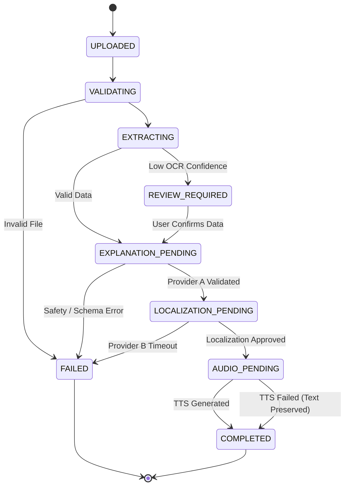

# LisanHealth — Software Requirements Specification (SRS)

**Document Version:** 1.0.0  
**Status:** Approved  
**Traceability Base:** LisanHealth Master Architecture

---

## 1. System Overview
The LisanHealth system ingests medical laboratory reports (PDF or image format), deterministically parses biochemical and hematological indicators, grounds educational explanations via **AI Provider A**, translates and localizes the content into **Amharic** and **Afaan Oromoo** via **Addis AI (Provider B)**, and generates natural audio output.

---

## 2. Functional Requirements (FR)

| Requirement ID | Module | Description | Acceptance Criteria |
| :--- | :--- | :--- | :--- |
| **FR-001** | System API | Health & Readiness check endpoints (`/api/v1/health`, `/api/v1/ready`). | Returns HTTP 200 with service status, version, and dependency check within 50ms. |
| **FR-002** | Upload | Accept PDF, PNG, and JPEG files up to 10MB. | Files exceeding 10MB or invalid MIME types are rejected with HTTP 400 and clear error detail. |
| **FR-003** | Extraction | Deterministically extract lab test name, observed value, unit, and reference interval. | Source numbers, decimal points, signs, and units must remain identical to the source document. |
| **FR-004** | OCR Fallback | Perform OCR on scanned image reports with uncertainty tagging. | Low confidence extractions ($< 80\%$) must be flagged with `needs_review: true`. |
| **FR-005** | Unit Validation | Prevent missing or altered units across pipeline boundaries. | Pipeline aborts with a validation error if output values deviate from Stage A inputs. |
| **FR-006** | Provider A Reasoning | Generate plain-English explanations of what each test measures and note out-of-range flags. | Must not diagnose disease, prescribe medications, or invent missing reference ranges. |
| **FR-007** | Doctor Questions | Provider A generates 2-4 clarifying questions the patient can ask their physician. | Questions must be relevant to observed out-of-range values or clinical context. |
| **FR-008** | Provider B Addis AI | Localize approved English explanation into selected language (`en`, `am`, `om`). | Localization must preserve numbers, units, warnings, and disclaimer sections verbatim. |
| **FR-009** | Addis AI TTS | Synthesize spoken audio for localized text in Amharic and Afaan Oromoo. | Audio stream/file is returned; if TTS fails, localized text must remain accessible without crashing. |
| **FR-010** | Safety Disclaimer | Prominently attach an explicit educational disclaimer to every explanation. | Disclaimer appears in both text and speech, reiterating consultation with a doctor. |
| **FR-011** | User Language Selection | Allow user to choose output language (`English`, `Amharic`, `Afaan Oromoo`). | System switches prompt context and localization target accordingly. |
| **FR-012** | State Machine | Expose explicit job processing states. | Valid state transitions: `UPLOADED` $\rightarrow$ `EXTRACTING` $\rightarrow$ `EXPLAINING` $\rightarrow$ `LOCALIZING` $\rightarrow$ `AUDIO_SYNTHESIS` $\rightarrow$ `COMPLETED` (or `FAILED`). |

---

## 3. Non-Functional Requirements (NFR)

| Requirement ID | Category | Description | Target Metric |
| :--- | :--- | :--- | :--- |
| **NFR-001** | Performance | API latency for deterministic endpoints. | $P_{95} \le 100\text{ ms}$ for non-AI routes. |
| **NFR-002** | Reliability | Graceful degradation on AI provider failure. | Return user-friendly error message; no unhandled 500 server crashes. |
| **NFR-003** | Security | Secret protection and credential safety. | Zero API keys committed or exposed to the client browser. |
| **NFR-004** | Privacy | Storage and transmission of patient health information. | Uploaded documents stored privately; no PHI logged in plaintext application logs. |
| **NFR-005** | Observability | Prometheus metrics instrumentation. | Expose request counts, error rates, and AI provider latencies on `/metrics`. |
| **NFR-006** | Usability | Responsive design supporting mobile and desktop. | Form factor support down to 320px viewport width. |
| **NFR-007** | Accessibility | High contrast text and screen-reader accessibility. | WCAG 2.1 AA compliance; native Ge'ez font rendering. |
| **NFR-008** | Portability | Containerization across environments. | Linux/Windows cross-platform reproducibility via Docker & Docker Compose. |
| **NFR-009** | Testability | Test coverage for pipeline logic and schemas. | $\ge 85\%$ test coverage on deterministic pipeline services. |
| **NFR-010** | Maintainability | Modular code architecture with clear boundaries. | Loose coupling between Provider A, Provider B, extraction, and presentation. |

---

## 4. Data Contracts & State Machine

