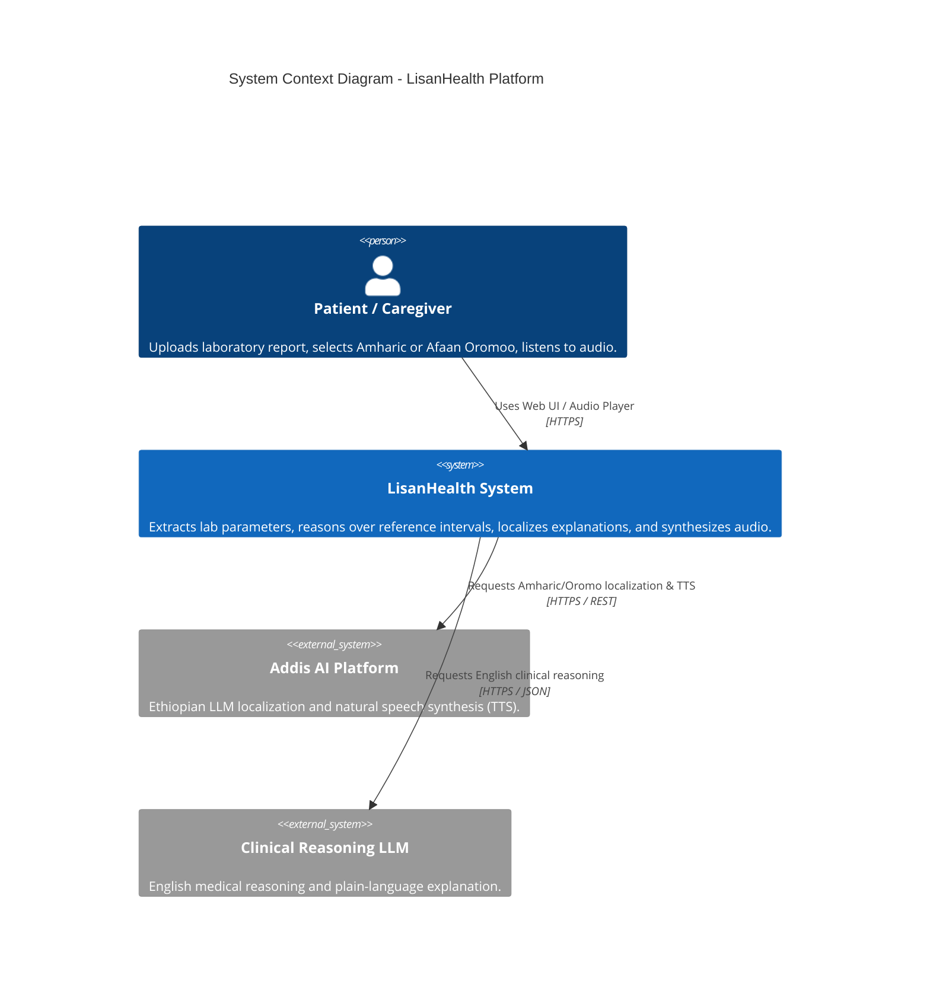
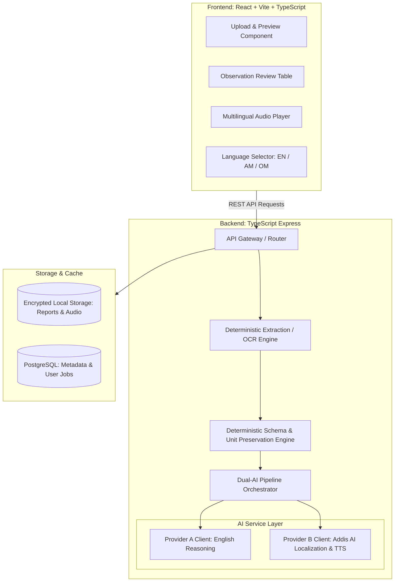
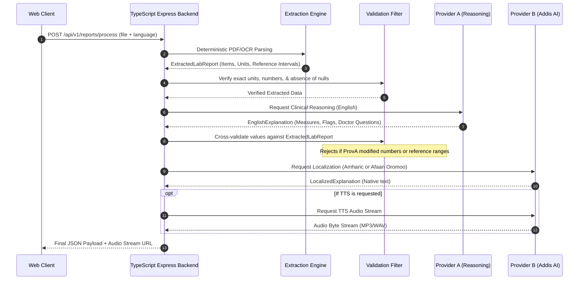

# LisanHealth Architecture & Technical Design

**Document Version:** 1.0.0  
**Status:** Approved  
**System:** Multilingual Medical Laboratory Explainer Platform

---

## 1. System Context & C4 Container Diagram

---

## 2. Component Architecture

---

## 3. Dual-AI Pipeline Data Flow & Safety Boundary

The sequential pipeline isolates clinical reasoning from linguistic localization to guarantee safety:

---

## 4. Key Architectural Decisions

1. **Decoupled AI Roles:** Addis AI is prioritized for native Ethiopian languages and speech synthesis, while an evidence-grounded reasoning model (Provider A) handles structured English clinical reasoning.
2. **Deterministic Safety Shield:** No LLM is permitted to directly parse raw PDFs or invent values. The intermediary deterministic filter strictly enforces that input numbers equal output numbers.
3. **Stateless Scalability:** Processing jobs are designed to be stateless, with audio generated on demand or stored in ephemeral private cache with TTL expirations.
4. **DevOps Progression:** Architecture evolves from Docker Compose in Phase 1 $\rightarrow$ Kind & Helm in Phase 2 $\rightarrow$ Cloud Ingress & Prometheus in Phase 3 $\rightarrow$ Terraform GitOps in Phase 4.
