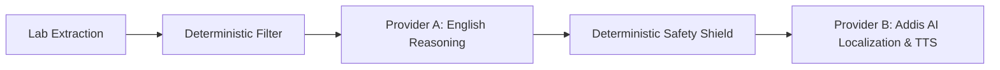

# ADR-0001: Decoupling Clinical Reasoning (Provider A) and Ethiopian Linguistic Localization (Provider B Addis AI)

**Status:** Accepted  
**Date:** 2026-10-22  
**Deciders:** Full-Stack & DevOps Engineering Team

---

## 1. Context & Problem Statement
LisanHealth requires both:
1. High-fidelity, evidence-grounded clinical reasoning over laboratory reference ranges in plain English.
2. Authentic, natural localization and speech synthesis in Ethiopian languages (**Amharic** and **Afaan Oromoo**).

Generic monolithic LLMs (e.g., standard multilingual chatbots) present two acute failure modes when tasked with end-to-end report translation in one shot:
- They frequently hallucinate altered numerical values or reference intervals when translating clinical terms into low-resource scripts like Ge'ez.
- They lack native high-quality text-to-speech (TTS) engines calibrated for Ethiopian accents, natural Ge'ez phonology, and Afaan Oromoo grammar.

Conversely, specialized localization engines like **Addis AI** excel in Ethiopian languages, cultural phrasing, and speech synthesis, but benefit from receiving pre-structured, evidence-verified clinical reasoning rather than raw unconstrained lab tables.

---

## 2. Decision
We adopt a **Dual-AI Sequential Pipeline** architecture:

1. **Stage A & B (Deterministic Core):** PDF/OCR extraction and schema validation deterministically parse lab observations, units, and intervals without AI.
2. **Stage C (AI Provider A — Clinical Reasoning):** An evidence-grounded reasoning model interprets the extracted data in English, explaining test purposes, highlighting out-of-range flags, and drafting clinician discussion points.
3. **Stage D (Deterministic Safety Filter):** A non-negotiable validation barrier confirms that Provider A did not alter numbers, invent reference ranges, or emit diagnostic declarations.
4. **Stage E & F (AI Provider B — Addis AI):** The approved English explanation is passed to **Addis AI** for translation into the user's chosen language (Amharic or Afaan Oromoo) and subsequent speech synthesis (TTS).

---

## 3. Alternatives Considered

### Option 1: Monolithic Single-Prompt Translation
- **Pros:** Simpler code, single API call.
- **Cons:** High risk of numerical hallucinations, difficulty enforcing safety barriers, poor Amharic/Oromo TTS integration. *Rejected.*

### Option 2: Generic Machine Translation (e.g., Google Translate API)
- **Pros:** Established API.
- **Cons:** Inflexible medical localization, lack of conversational Amharic/Afaan Oromoo speech synthesis, no support for Ethiopian context. *Rejected.*

---

## 4. Consequences
- **Positive:** Maximum safety control; numerical values remain immutable; Addis AI powers authentic Ethiopian localization and native speech; easily mockable in CI tests.
- **Trade-off:** Sequential latency (2 API hops). Mitigated by caching, async worker jobs, and stream playback.
