# LisanHealth Implementation Plan & 11-Week DevOps Roadmap

**Document Version:** 1.0.0  
**Status:** Approved

---

## 1. Two-Day MVP Sprint Plan (Vertical Slice)

The intensive two-day sprint establishes a verified working vertical slice of LisanHealth:

```mermaid
gantt
    title LisanHealth 2-Day MVP Sprint Schedule
    dateFormat  HH:mm
    axisFormat  %H:%M
    
    section Day 1: Foundation & Extraction
    Repo Init & Docs Suite        :done, d1_1, 00:00, 2h
    TypeScript Express Health & Core API     :active, d1_2, after d1_1, 3h
    Synthetic Schemas & Parsing   :d1_3, after d1_2, 3h
    Frontend Skeleton & UI Tokens :d1_4, after d1_3, 3h
    Dockerization & Compose Check :d1_5, after d1_4, 2h

    section Day 2: AI & Localization
    Provider A Reasoning Service  :d2_1, after d1_5, 3h
    Addis AI Adapter (AM/OM/TI)      :d2_2, after d2_1, 3h
    Dual-AI Pipeline Integration  :d2_3, after d2_2, 3h
    Addis AI TTS Voice Synthesis  :d2_4, after d2_3, 2h
    CI Pipeline & Kind Validation :d2_5, after d2_4, 2h
```

### Day 1 Deliverables
- **TASK-01:** Repository initialization, documentation suite, and environment templates. *(Completed)*
- **TASK-02:** TypeScript Express service with structured health checks (`/api/v1/health`), versioning, and test suites.
- **TASK-03:** Synthetic laboratory report parser with TypeScript schema validation (CBC, Lipid, Metabolic panels) and unit preservation tests.
- **TASK-04:** React + Vite + TypeScript frontend with language selection, upload preview, and observation display.
- **TASK-05:** Multi-stage `Dockerfile` and `docker-compose.yml` with health check verification.

### Day 2 Deliverables
- **TASK-06:** Provider A reasoning interface with deterministic mock test fixtures and question generator.
- **TASK-07:** Provider B Addis AI localization adapter with support for English, Amharic, Afaan Oromoo, and Tigrinya.
- **TASK-08:** Dual-AI sequential pipeline orchestrator with schema and value verification filters.
- **TASK-09:** Addis AI TTS audio service with play/pause playback controls on the web UI.
- **TASK-10:** GitHub Actions CI workflow (linting, tests, container builds) and local Kubernetes Kind proof-of-concept.

---

## 2. 11-Week DevOps Portfolio Roadmap

| Phase | Weeks | Focus Area | Deliverables & Milestones | Repository Evidence |
| :--- | :--- | :--- | :--- | :--- |
| **Phase 1** | **Weeks 1–3** | **Linux & Containerization** | Linux shell scripting, multi-stage Docker builds, non-root user security, Docker Compose networking and health checks. | `Dockerfile`, `docker-compose.yml`, health checks |
| **Phase 2** | **Weeks 4–6** | **CI/CD & Local Orchestration** | GitHub Actions matrix testing, automated image tagging, Kubernetes cluster on `kind`, Helm charts for frontend & backend. | `.github/workflows/ci.yml`, `k8s/`, `helm/` |
| **Phase 3** | **Weeks 7–9** | **Cloud & Observability** | Cloud infrastructure fundamentals (AWS/GCP), Nginx Ingress Controller, Prometheus metrics exporter, Grafana dashboards. | `ingress/`, `monitoring/prometheus.yml`, `dashboards/` |
| **Phase 4** | **Weeks 10–11** | **IaC & GitOps** | Terraform modules for infrastructure provisioning, ArgoCD or Flux GitOps automated sync, final security audit. | `terraform/`, `gitops/` manifests |

---

## 3. Definition of Done (DoD)

A task is officially marked **Done** only when:
1. Code changes are accompanied by automated unit or integration tests.
2. All tests pass cleanly in Windows PowerShell.
3. Linting, type checks, and build validations succeed.
4. Git diff is inspected to ensure zero secrets, junk files, or unrelated edits exist.
5. Documentation is synchronized with the new state.
6. A descriptive Conventional Commit message is recorded.
