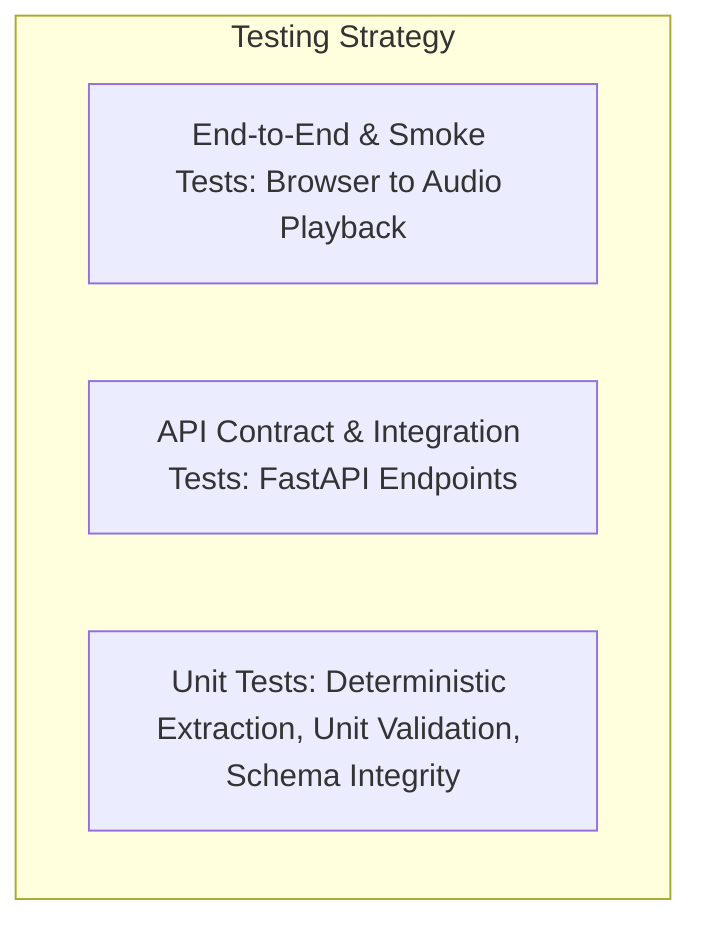

# LisanHealth Testing Strategy & Test Matrix

**Document Version:** 1.0.0  
**Status:** Approved

---

## 1. Testing Pyramid & Principles



### Core Testing Rules
1. **Mock AI Providers by Default:** Automated CI test suites must run deterministically without requiring paid or active internet API connections.
2. **Synthetic Data Only:** Tests run against pre-fabricated synthetic lab fixtures representing typical panels (Complete Blood Count, Lipid Panel, Comprehensive Metabolic Panel).
3. **Safety & Zero-Hallucination Invariant:** Every test verifying the explanation pipeline must assert that observed numbers, decimal places, and units in the input match the output.
4. **Limits of Software Testing:** Software test passes verify schema, stability, and preservation; they do **not** constitute clinical accreditation.

---

## 2. Test Suites & Commands (Windows PowerShell)

### Backend Tests (Pytest)
```powershell
# Run all unit and integration tests
pytest backend/tests -v

# Run with test coverage report
pytest backend/tests --cov=backend/app --cov-report=term-missing

# Run focused unit tests for extraction validation
pytest backend/tests/test_extraction.py -k "test_unit_preservation"
```

### Frontend Tests (Vitest)
```powershell
# In frontend directory
cd frontend
npm run test:run
```

### Container Health & Smoke Test
```powershell
# Test Docker container health endpoints
docker compose up -d --build
curl http://localhost:8000/api/v1/health
docker compose down
```

---

## 3. Synthetic Fixtures Catalogue

| Fixture Name | Category | Tested Scenarios |
| :--- | :--- | :--- |
| `synthetic_cbc_normal.json` | Hematology | Normal WBC, RBC, Hemoglobin, Platelets. Clean extraction. |
| `synthetic_cbc_anemia.json` | Hematology | Low Hemoglobin ($9.2\text{ g/dL}$), normal platelets. Verifies out-of-range flag and doctor question generation. |
| `synthetic_lipid_panel.json` | Biochemistry | High Total Cholesterol ($245\text{ mg/dL}$), LDL ($160\text{ mg/dL}$). Verifies non-diagnostic educational explanation. |
| `synthetic_malformed_ocr.json` | Extraction Edge Case | Missing units, blurred reference range. Verifies `needs_review: true` status. |
