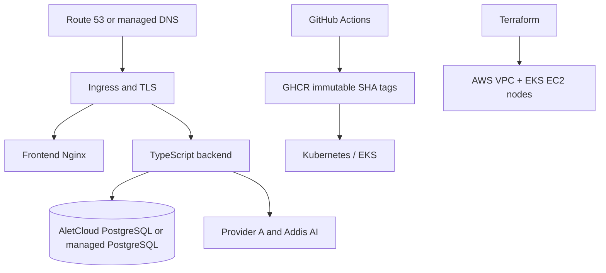

# LisanHealth Infrastructure and DevOps Guide

This directory contains reproducible deployment and validation assets for Docker Compose, Kubernetes/Kustomize, Helm, Terraform on AWS, monitoring, and GitOps. It describes deployment paths; it does not claim that an AWS account has already been deployed.

## Topology



## Layout

```text
infrastructure/
├── k8s/                 # Kustomize base and dev/prod overlays
├── helm/lisan-health/   # Helm chart and environment values
├── terraform/           # AWS VPC, EKS, and environment modules
├── monitoring/          # Prometheus, Grafana, and alert definitions
├── gitops/argocd/       # Optional ArgoCD declarations
└── docker/              # Local monitoring Compose additions
```

## Validation

From the repository root run `kubectl kustomize infrastructure/k8s/overlays/dev`, `helm lint infrastructure/helm/lisan-health`, and `helm template infrastructure/helm/lisan-health -f infrastructure/helm/lisan-health/values-dev.yaml`. In `infrastructure/terraform/environments/prod`, run `terraform fmt -check -recursive`, `terraform init`, `terraform validate`, and `terraform plan -out=tfplan`. CI runs these checks with its configured tooling.

## Docker Compose

Run `docker compose config`, `docker compose up --build -d`, `docker compose ps`, and `docker compose down`. Compose is for local development and synthetic smoke tests; it does not provide production TLS, managed backups, multi-AZ availability, or cloud secret management.

## AWS path

Terraform provisions an AWS VPC and EKS cluster with EC2-backed worker nodes. Before `terraform apply`: configure remote encrypted state and locking; least-privilege AWS credentials/OIDC; region, CIDRs, node sizing and cost limits; DNS/TLS, ingress, network policies and security groups; secret-manager/Kubernetes Secret injection; AletCloud PostgreSQL TLS, allowlists, backups and restore testing; and a migration plan. Review the plan and apply only in an approved change window.

Repository validation is not proof of an AWS deployment. A real deployment requires account-specific smoke tests, monitoring, rollback, backup/restore evidence, and cost/security review.

## CI/CD evidence

GitHub Actions validates code, tests, containers, Kubernetes manifests, Helm, Terraform, dependency/security checks, and publishes immutable GHCR images when configured. ZAP and Trivy outputs should be retained and reviewed; advisory findings are not equivalent to a clean penetration test. Use commit-SHA image tags rather than mutable `latest` for deployment.

## Product language contract

Infrastructure is language-neutral, but every deployment must preserve English (`en`), Amharic (`am`), Afaan Oromoo (`om`), and Tigrinya (`ti`). Provider language mapping belongs in application configuration, not hard-coded infrastructure manifests.

**© 2026 Yeabsera Andnet · LisanHealth**
